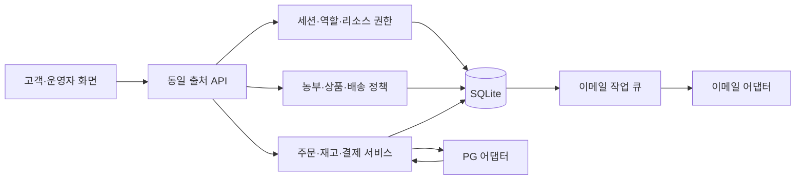

# 3단계: 기술·인증·데이터 구조 설계

후속 상태: [4단계 구현 기록](04-auth-implementation.md)에서 회원 인증을 구현했다. 이 문서의 ‘이번 단계/미구현’ 설명은 3단계 작성 시점이며 최신 실행은 4175 통합 앱을 따른다.

작성일: 2026-11-10. 기준: [요구사항 F01~F16](01-requirements.md), [화면 설계](02-screen-flows.md).

## 1. 이번 단계의 결과와 경계

기술 구성, 권한, 상태 전이, 데이터 모델, API 계약을 정의하고 실제 생성 가능한 SQLite 스키마와 예시 데이터 적재·검증 명령을 작성했다. 로컬 읽기 API로 DB를 시험할 수 있다. 기존 4173 화면은 아직 로컬 상수와 브라우저 저장소를 사용한다. **화면과 DB의 연결, 회원가입·로그인 처리는 다음 단계다.**

| 구분 | 결정 | 이유와 제한 |
|---|---|---|
| 고객 화면 | 기존 HTML·CSS·JavaScript 유지 | 현재 반응형 화면·페이징을 재사용하고 API 어댑터를 후속 연결 |
| 런타임 | Node.js 24.22.1 기준 | 현재 설치 버전에서 실행 검증. package.json은 24 계열로 범위 제한 |
| 서버 | Node.js HTTP, `/api/v1` JSON | 이번에는 읽기 전용 개발 서버. 인증·입력 검증·오류·보안 처리는 공통 모듈로 후속 구현 |
| 개발 DB | SQLite, Node 내장 `node:sqlite` | 외부 패키지 없이 개발 가능. 동기식 DB이므로 짧은 트랜잭션과 단일 서버 기준 |
| DB 파일 | 프로젝트 루트 `.farmer-market-data/market.sqlite` | 정적 웹 폴더 밖에 저장, Git 제외. 예시 데이터만 적재 |
| 사용자 인증 | 이메일·비밀번호 + 서버 세션 쿠키 | 브라우저 localStorage에 로그인 토큰을 저장하지 않음 |
| 비밀번호 | Node crypto 비동기 scrypt | 사용자별 무작위 16바이트 salt, N=131072/r=8/p=1, 키 64바이트, maxmem=256MiB를 초기 기준으로 실제 성능 검증 후 적용. 알고리즘·파라미터와 salt를 해시 형식에 보존 |
| PG | 토스페이먼츠를 최초 연동 대상로 선정 | 실제 계약·키 미준비. 승인/조회/취소를 결제 어댑터 뒤로 분리. 현재 호출 없음 |
| 이메일 | SMTP 어댑터 + DB 작업 큐 | 서비스 제공사·발신 도메인 미정. 개발 환경 발송 기본값 disabled. 비밀 키는 서버 환경에만 보관 |
| 이미지 | 개발은 일러스트·로컬 사진, 운영은 파일 저장소 | DB에는 파일 키와 메타데이터만 저장. 관리자 업로드의 형식·크기·실제 이미지 디코딩·경로 제한을 후속 구현 |
| 운영 배포 | Node 단일 서버 + 영속 디스크 + HTTPS 리버스 프록시 | 서버리스 임시 디스크에 SQLite 배치 금지. 사업자·예산·호스팅 계정 미정이므로 업체/도메인 생성·배포 미수행 |
| 확장 | 다중 인스턴스가 필요해지면 PostgreSQL 검토 | SQLite 파일 공유로 서버 수를 늘리지 않음. 현재 SQL은 SQLite용이며 자동 호환을 가정하지 않음 |

## 2. 모듈과 통신



이는 목표 구조다. 이번 실행 코드는 DB 초기화와 공개 목록 읽기까지다. 개발 API 4174와 화면 4173은 시험용으로 나뉘며 아직 상호 연결되지 않았다. 정식 연결 시 동일 출처로 제공하거나 개발 프록시를 사용하고 무제한 CORS를 켜지 않는다.

## 3. 회원·세션 설계

1. 가입은 정규화한 이메일·비밀번호·정책 버전을 검증한다. 이메일 공백 제거·소문자 통일, 비밀번호 12~128자, 원문/해시/토큰 로그 금지. 역할은 서버가 customer로 설정하며 요청의 role을 신뢰하지 않는다.
2. `pending` 사용자와 이메일 확인 토큰을 생성한다. 토큰은 무작위 32바이트, DB에는 SHA-256 해시만 보관한다. 메일 작업과 사용자 생성은 같은 트랜잭션으로 저장한다.
3. 이메일 링크의 GET은 확인 화면만 보여주며 POST로 토큰을 원자적으로 소비한다. 메일 스캐너가 GET으로 토큰을 소모하지 않게 한다. 이메일 확인 30분, 비밀번호 재설정 15분, 비회원 조회 확인 15분을 기본 TTL로 한다.
4. 이메일 확인 후 active로 전환한다. 로그인은 active 상태와 비밀번호를 확인한 후 새 세션을 발급한다. 실패 응답은 계정 존재·확인 여부를 구별하지 않는다. 미확인 계정의 확인 메일 재요청은 별도 경로로 제공한다.
5. 세션 ID는 무작위 32바이트이며 DB에는 해시만 저장한다. 운영 쿠키는 `__Host-session; HttpOnly; Secure; SameSite=Lax; Path=/`, Domain 없음. 로컬 HTTP 시험만 별도 개발 쿠키를 사용한다. 일반 고객은 유휴 30분·절대 24시간, 관리자는 유휴 15분·절대 8시간 후 만료한다.
6. 로그인·권한 변경 시 세션을 교체한다. 로그아웃은 서버 폐기 후 쿠키를 지운다. 비밀번호 변경·재설정은 이전 세션과 재설정 토큰을 모두 폐기한다.
7. 모든 변경 요청은 Origin 검증과 세션에 연결된 CSRF 토큰을 요구한다. 회원가입·로그인에는 가입 전 CSRF 토큰을 발급한다. PG 웹훅은 이 검사 대신 제공사 검증·서버 결제 조회를 적용한다.
8. 로그인은 IP 및 정규화 이메일 해시 기준으로 각각 15분에 5회 실패부터 제한한다. 확인/재설정 메일은 대상별 60초 간격·시간당 5회, IP별 시간당 20회를 초기값으로 둔다. 장기 계정 잠금으로 타인의 계정을 막지 않도록 지연·429 응답을 사용한다.
9. 관리자 계정은 공개 가입으로 만들지 않는다. 보호된 로컬 CLI로 생성/승격하고 감사 기록을 남기는 방식을 다음 구현에서 제공한다. 기본 관리자 비밀번호·공유 계정은 생성하지 않았다.

## 4. 권한과 개인정보

| 주체 | 허용 범위 |
|---|---|
| 방문자 | 공개 농부·상품·게시물 조회, 비회원 구매 진입·견적 접수·알림 신청 |
| 회원 | 자신의 장바구니·주문·취소 요청·후기·문의·알림 |
| 비회원 확인 세션 | 확인한 주문 1개와 그 주문의 후기·취소 요청. 다른 주문 열람 금지 |
| 농부 링크 | 지정한 배송 묶음 1개에 필요한 품목·수량·수령/배송 정보. 전체 주문·다른 농부·고객 계정 접근 금지 |
| 공동 운영자 | 서버 admin 권한 확인 후 통합 관리. 변경·재전송·환불 승인 감사 기록 |

비회원 조회는 주문번호+이메일을 입력해도 즉시 정보를 반환하지 않고 일관된 202 응답 후 일회용 확인 링크를 발송한다. 링크 소비 후 주문 한정 쿠키 세션을 별도로 발급한다. 일반 회원 세션으로 승격하지 않는다. 이메일 확인만으로 다른 회원 주문을 자동 연결하지 않는다.

농부 주문 링크 TTL은 기존 기준인 72시간이며 링크 재발급·폐기를 지원한다. 조회용 링크는 유효 기간 중 여러 번 열 수 있지만 일회용 교환으로 제한된 세션을 만드는 방식을 권장한다. 토큰은 `access_tokens`에서 목적·배송 묶음·만료를 함께 검증한다. 링크 페이지는 no-store·no-referrer를 사용하고 외부 리소스를 불러오지 않는다.

실제 개인정보 수집 전에 정책·보유 기간·위탁/제공 관계를 확정한다. DB 파일·백업의 디스크 암호화와 운영 계정 접근 제한을 배포 조건으로 한다. API 로그와 감사 로그에는 주소·연락처·이메일 본문·비밀번호·토큰 원문을 기록하지 않는다.

## 5. 주문·재고·결제 흐름

1. 서버가 옵션·가격·판매 상태·주소 가능 지역·농부별 배송 정책을 다시 계산한다. 브라우저 합계를 결제의 근거로 사용하지 않는다.
2. 멱등키와 요청 본문 해시를 확인한다. 같은 사용자·키·내용이면 기존 결과를 반환하고 내용이 다르면 409로 거절한다.
3. 짧은 `BEGIN IMMEDIATE` 트랜잭션에서 옵션별 `stock-reserved >= quantity` 조건으로 reserved를 증가시키고 15분 유효 예약·pending_payment 주문·배송 묶음·금액/정책 스냅샷을 함께 생성한다. 실패하면 전부 롤백한다.
4. PG 호출은 DB 트랜잭션 밖에서 수행한다. 성공 리다이렉트만으로 결제를 확정하지 않는다. 서버가 PG의 주문번호·결제키·금액·상태를 조회/승인 검증한다.
5. 검증된 결제는 같은 트랜잭션에서 paid·confirmed로 전환하고 예약을 consumed로 변경, stock와 reserved를 함께 감소시킨다. 농부별 이메일 작업도 이때 생성한다.
6. 통보는 provider+event_id로 중복 제거하며 같은 결제 확정을 여러 번 실행하지 않는다. 금액 불일치·확인 시간 초과·늦은 결제는 review/payment_review에 두고 재조회·환불 또는 운영자 확인으로 해결한다.
7. 예약 만료 작업은 결제 확인 중인 주문을 먼저 PG 재조회한다. 미결제 확인 후 held→released와 reserved 감소를 같은 트랜잭션으로 실행한다. 늦은 승인은 재고를 다시 확보할 수 있는지 검증하며, 확보 실패 시 자동 주문 확정 대신 환불/검토 처리한다.
8. 상품명·단가·규격·농부명·배송 정책은 주문 시점 스냅샷을 사용한다. 상품 수정이 과거 주문 금액을 바꾸지 않는다.

| 상태 영역 | 대표 상태 |
|---|---|
| 주문 | pending_payment → confirmed → completed, 분기 partially_cancelled/cancelled/expired/payment_review |
| 결제 | ready → confirming → paid → partially_refunded/refunded, 분기 failed/review |
| 배송 묶음 | preparing → shipped → delivered, 출고 전 cancelled |
| 재고 예약 | held → consumed 또는 released |
| 이메일 전달 | queued → sending → accepted, 실패 시 queued 재시도 또는 failed |

DB CHECK는 허용 상태만 제한한다. 이전 상태와 다음 상태의 적법성·환불 합계·재고 예약 합계·주문/결제 금액 일치는 서비스 트랜잭션에서 후속 구현하고 테스트한다.

## 6. 취소·이메일·알림

- 부분 취소는 대상 item과 취소 수량을 잠금·검증하고 환불 요청 키로 중복을 막는다. 상품 환불액과 농부별 배송비 조정 산식은 실제 판매 정책을 확정한 뒤 적용한다. PG 환불 실패/불명확 상태는 review로 보존하고 재조회한다. 결제 성공/환불 실패를 화면 성공으로 숨기지 않는다.
- DB 작업 큐는 dedupe_key로 동일 이벤트의 중복 등록을 막는다. 워커가 lease_until을 사용해 작업을 점유하며 죽은 워커의 점유를 회수한다. 실패 후 1분·5분·30분 간격으로 3회 재시도(최초 포함 최대 4회), 이후 운영자 확인으로 보낸다.
- SMTP는 발송 후 응답 유실 시 정확히 한 번 배달을 보장하지 못한다. 메시지 ID·시도 기록을 보존하고 중복 가능성을 안내하며, 제공사의 멱등 지원이 있으면 함께 적용한다. accepted는 수신자 열람·실제 출고 완료가 아니다.
- 재입고/수확은 상품 sale_round별로 구독과 발송 키를 관리한다. 이메일 확인 전에는 발송 대상이 아니다. 발송 직전 active/해지 여부를 재검사한다. 재입고는 sold_out→on_sale, 수확은 scheduled→on_sale 전환에 연결한다.
- 고객 DTO에는 이메일 전달 상태·실패 사유·농부 이메일을 포함하지 않는다. 운영자 DTO와 분리한다.

## 7. 개발 환경과 실행

프로젝트 루트에서 실행한다.

```powershell
# DB 생성·예시 농부 10명/상품 13개 적재 (기존 레코드 덮어쓰기 없음)
node farmer-market/backend/database.cjs --seed-demo

# 로컬 읽기 API 실행 (화면 서버와 별개)
node farmer-market/backend/dev-server.cjs

# DB 무결성·제약·API 통합 검증, 외부 서비스 호출 없음
node farmer-market/backend/verify.cjs
```

전체 검증은 `node farmer-market/verify-all.cjs`로 실행한다. 현재 환경에는 npm이 없으므로 위 Node 명령을 기본으로 사용한다. npm이 설치된 다른 환경에서는 `farmer-market` 폴더의 `npm run db:init`, `npm run api`, `npm test`도 사용할 수 있다. 의존성 설치는 필요 없다. `.env.example`은 후속 설정의 이름만 정리한 참조 파일이며 현재 코드가 자동 로드하지 않는다. 현재 서버 주소와 포트는 코드의 로컬 기본값이다.

| 주소 | 현재 동작 |
|---|---|
| `http://127.0.0.1:4173/` | 기존 화면 미리보기, 브라우저 저장 데이터 |
| `http://127.0.0.1:4174/api/health` | 서버/스키마 상태, 인증·결제·메일 미구현 표시 |
| `http://127.0.0.1:4174/api/v1/farmers?page=2&pageSize=9` | DB의 예시10 조회 |
| `http://127.0.0.1:4174/api/v1/products?farmerId=example-10` | DB의 나주 배와 옵션 조회 |

개발 API를 실행한 동안만 4174에 접속할 수 있다. 3단계 서버의 POST는 405이며 로그인 API는 아직 없다. DB는 테스트용 예시만 적재하고 계정·개인정보·키는 만들지 않았다. DB와 localStorage는 자동 동기화되지 않으며 다음 단계에서 단일 서버 데이터로 연결한다.

## 8. 배포 준비와 다음 구현

- 로컬 개발은 진행 가능하다. 실제 운영을 위해 호스팅·영속 디스크·도메인·HTTPS·백업·복구 시험, PG 테스트/운영 키, SMTP·발신자 인증, 사업자/정책 자료가 필요하다.
- 최초 연동 대상 PG는 선정했으나 계약·키 발급·전송·결제는 수행하지 않았다. 이메일 제공사는 계정과 도메인이 준비될 때 확정한다.
- SQLite 운영 적합성은 예상 동시 주문량·백업 및 복구 목표를 받은 뒤 확인한다. 백업은 파일 단순 복사보다 일관된 DB 백업 방식을 사용하고 복구를 시험한다.
- 다음 구현 순서: 인증 모듈·세션·권한 및 가입/로그인 화면 → 농부·상품 DB 연결 → 장바구니/주문 → PG → 관리자/전달 워커 → 고객 소통 기능.
- 로그인 검증 기준: 가입·이메일 확인·로그인·로그아웃·만료·재설정·중복 이메일·오류 횟수 제한·CSRF·본인 데이터만 조회·일반 고객의 관리자 접근 거부. 확인 메일은 개발 모드의 로컬 테스트 수신함으로 확인하고 운영 모드에 노출하지 않는다.

## 9. 기술 근거

현재 환경의 Node 24.22.1에서 DatabaseSync API와 실제 DB 생성·제약·트랜잭션을 실행 확인했다. 최신 문서의 버전이 환경과 다를 수 있으므로 런타임 범위와 실행 검증을 함께 유지한다.

- [Node.js SQLite 공식 문서](https://nodejs.org/api/sqlite.html): 내장 DB·prepared statement·트랜잭션 관련 API 참고.
- [Node.js crypto 공식 문서](https://nodejs.org/api/crypto.html): 비동기 scrypt·무작위 토큰·타이밍 안전 비교 참고.
- [OWASP 세션 관리](https://cheatsheetseries.owasp.org/cheatsheets/Session_Management_Cheat_Sheet.html): 쿠키 속성·세션 수명·교체 기준 참고.
- [토스페이먼츠 보안과 신뢰](https://docs.tosspayments.com/reference/using-api/security-trust): 금액 대조·중복 처리 방지와 키 보호 참고.

위의 수명·재시도·제한 횟수와 배포 구성은 본 프로젝트의 설계 선택이며 외부 문서가 정한 운영 수치라는 의미가 아니다.
