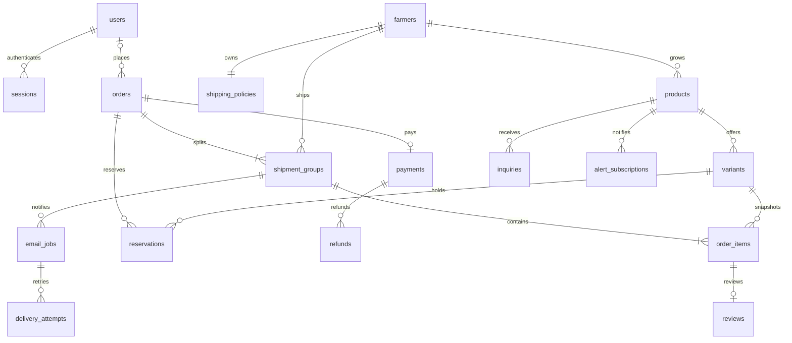

# 3단계: DB 모델

실행 스키마: [schema.sql](../farmer-market/backend/schema.sql). SQLite STRICT 테이블, 텍스트 ID, 정수 원화 금액, UTC 시각을 사용한다. 개인정보 필드는 실제 수집 전이며 예시 시드에는 계정·주문 정보를 적재하지 않는다.

## 관계

ER의 1개 이상 상품·배송 묶음 규칙은 주문 생성 서비스가 하나의 트랜잭션으로 보장한다. SQL 외래키만으로 빈 주문 생성을 완전히 막는 것은 아니다.

## 테이블과 책임

| 영역 | 테이블 | 주요 규칙 |
|---|---|---|
| 회원 | users | 대소문자 무관 이메일 유일, 해시만 저장, customer/admin, pending/active/disabled |
| 세션 | sessions | 토큰 해시 유일, 사용자·CSRF 해시·만료·폐기 |
| 농부 | farmers | 소개·공개·순서·예시 표시, 운영자 전용 수신 이메일 |
| 배송 | shipping_policies | 농부별 기본료·무료 기준·주소 규칙 JSON·버전 |
| 상품 | products | 농부·분류·판매 상태·원산지·보관·발송 안내·판매 회차 |
| 옵션 | variants | 옵션별 가격·재고·예약 수량, reserved ≤ stock |
| 장바구니 | carts, cart_items | 회원 또는 익명 해시 토큰 한 가지 소유 방식, 옵션별 수량 |
| 주문 | orders | 회원 ID는 비회원일 때 NULL, 주문자·배송지 스냅샷, 합계 = 상품+배송 |
| 배송 묶음 | shipment_groups | 주문+농부 유일, 농부명·정책 스냅샷·운송장·배송 상태 |
| 주문 항목 | order_items | 묶음/상품의 농부 ID 일치, 옵션의 상품 ID 일치, 가격·규격 스냅샷 |
| 예약 | reservations | 주문+옵션 유일, held/consumed/released, 만료 |
| 결제 | payments | 주문당 1개 결제 레코드, PG 키 유일, 결제/누적환불 금액·검증 시각 |
| 결제 통보 | payment_events | 제공사+이벤트 ID 유일, 원문 대신 payload 해시, 처리 시각 |
| 환불 | refunds | 요청 키 유일, 대상 항목 JSON·금액·처리 상태 |
| 목적별 토큰 | access_tokens | 해시·목적·사용자/주문/묶음/리소스 범위·만료·사용·폐기 |
| 전달 | email_jobs, delivery_attempts | 중복 방지 키·작업 점유·다음 실행·시도별 결과 |
| 후기 | reviews | 주문 항목당 1개, 1~5점, 숨김·삭제, 구매·배송 완료 자격은 서비스 검증 |
| 상품 문의 | inquiries | 비공개 기본, 작성자·답변자·답변 시각 |
| 알림 | alert_subscriptions | 상품+이메일+종류+판매 회차 유일, 확인·동의 버전·해지 |
| 견적 | business_quotes | 업체·담당자·공급 희망·납기·배송지·접수/회신 상태 |
| 콘텐츠 | content_pages | 이야기·공지·FAQ·정책, 공개·버전 |
| 동의 | consent_records | 목적·문서 버전·동의 여부·기록 시각 |
| 중복 요청 | idempotency_keys | scope+actor_hash+key 유일, 본문 해시·결과·처리 상태 |
| 감사 | audit_logs | 행위자·대상·행동·민감정보 제외 요약 |

## 서비스 계층에서 보장할 규칙

`scoped_sessions`는 회원 sessions와 별도로 비회원 주문·농부 배송 묶음·비회원 문의의 한정 세션을 저장한다. token_hash·csrf_hash·만료·폐기와 대상 FK를 가지며 목적에 따라 대상 하나만 지정하도록 CHECK로 제한한다. 이를 통해 비회원 확인을 회원 로그인 권한과 분리한다.

- 이메일 확인 토큰과 비회원 조회 세션은 목적·대상·만료를 함께 검사한다. 토큰 목적에 맞는 FK 조합과 resource_id는 서비스에서 검증한다.
- 주문 소유자·운영자 권한·농부 링크 범위는 매 요청 검증한다. SQLite가 자체적으로 사용자별 행 권한을 제공하는 것으로 가정하지 않는다.
- 결제 금액=주문 총액, 배송 묶음 합계=주문 배송 합계, 항목 합계=주문 상품 합계, 예약 합계=옵션 reserved를 서비스 트랜잭션으로 맞춘다.
- 환불은 본래 결제와 같은 주문의 결제 ID만 사용하며 누적 환불·수량을 초과하지 않게 검증한다. 다른 주문 간 참조는 FK만으로 모두 방지하지 않는다.
- 이메일 payload에는 발송 시점에 필요한 최소 정보만 담고 농부 링크·작업 접근을 제한한다. 사용/만료된 원문 링크를 장기 보존하지 않는다.
- 배송 조회 상태·환불·전달 성공은 서로 독립적이며 허용된 상태 전이와 감사 이력은 서비스에서 기록한다.

## 마이그레이션·시드

현재 스키마는 `PRAGMA user_version=2`다. 버전 0에서는 `schema.sql`을 트랜잭션으로 적용해 버전 1을 만들고, `002-scoped-sessions.sql`로 범위 한정 세션을 추가해 버전 2로 올린다. 기존 버전 1 DB도 데이터를 보존하며 순차 적용한다. 실패 시 해당 변경을 롤백하고 더 높은 버전 DB는 이 코드로 열지 않는다. 후속 변경도 버전별로 추가하며 기존 파일 삭제·전체 재생성을 운영 절차로 사용하지 않는다.

예시 시드는 명시적 `--seed-demo`일 때만 실행한다. 동일 ID는 덮어쓰지 않아 운영자 수정·재고를 초기화하지 않는다. 시드 반복 실행은 데이터 업그레이드가 아니며, 후속 예시 변경도 별도 이관으로 처리한다. localStorage의 소개 수정·장바구니는 이 DB로 자동 복사되지 않는다.

사진은 파일 키로 저장한다. 외부 파일 저장 실패 시 DB에 불완전한 공개 기록을 남기지 않도록 업로드 확정 절차를 후속 설계한다. 정산은 농부별 주문/환불 조회를 기반으로 하고 수수료 산식·자동 지급 테이블은 이번에 확정하지 않았다.
